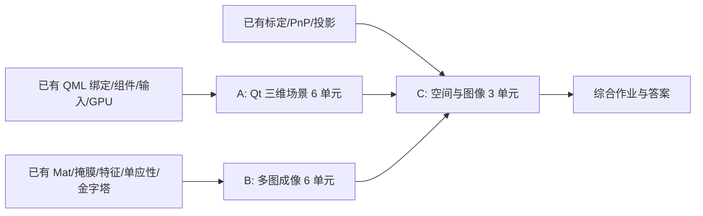
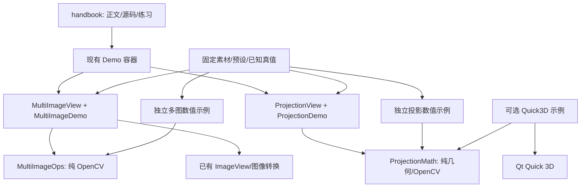

# 下一阶段内容架构：空间、成像与可解释的综合案例

状态：**本地实现已完成，尚未推送或发布**。设计基线：已发布的 `0.2.0`；实现收尾：2026-10-18。
本文保留设计依据、契约与实施顺序；读者正文已进入 `handbook/*.qml`。实际完成记录见 [SPATIAL_IMAGING_ROUND.md](SPATIAL_IMAGING_ROUND.md)。当前Qt62节、OpenCV60节；系统新增三课和综合练习。本轮不修改版本号、不推送、不发布。

## 1. 项目的实际目标与边界

VisionCraft 的主线是学习 Qt / QML 与 OpenCV，并通过真实源码、最小示例、可解释结果和练习建立理解。工位是综合案例，板子是通信、控制、采集和 FreeRTOS 的配套材料。课程覆盖范围可以超出工位。

下一阶段的学习终点：读者能够解释一个三维场景如何投影成图像、多张图像如何对齐与融合，以及几何模型、数据格式和显示效果各自的能力边界。交付单位是一个完整专题及其学习材料，而非工具按钮数或章节数量。

约束沿用用户要求：

- 下位机当前范围进入维护；不恢复 SD、外设、新接线、长期运行或供电组合任务。保留旧 Widgets 与 ST-Link/RTT。
- 机器学习暂不扩展。已有最小 DNN 课程保留。
- 不把教学案例扩成通用拼图软件、三维编辑器或工业生产系统。
- 正文在应用内展示，复用 Section / Para / CodeRef / Figure / Try / Theme。维护架构使用 Markdown；txt 只承担原始数值材料。
- 优先实际教学代码与正文；必要构建，少做截图和测试。新功能完成后集中本地提交，下一次远程发布需有相应用户指示。

## 2. 已核对的现状与证据

| 已有材料 | 源码依据 | 对下一阶段的影响 |
|---|---|---|
| Qt 56 节、OpenCV 54 节，另有衔接/F407/系统卷 | `handbook/Index.qml`、`LEARNING_MAP.md` | 不能把已有基础重新列为新课程 |
| Qt 音视频与 GPU 两轮完成 | `examples/qml/media`、`examples/qml/gpu`、`MEDIA_GPU_ROUND.md` | 新 Qt 专题衔接空间场景，不再重做播放器、纹理采样和片元模糊 |
| 标定、PnP、双目均已有生成数据和源码 | `examples/opencv/calib3d/main.cpp` 及对应正文 | 综合案例复用投影/位姿知识；增加跨坐标系说明和可操作视图 |
| ORB、单应性、RANSAC、金字塔、图像混合已有 | `examples/opencv/features`、`handbook/opencv/geometry/Homography.qml`、基础与滤波章节 | 新增多图画布、接缝、融合和曝光语义，不重写入门匹配课 |
| 应用中已有嵌入式教学演示 | `qml/handbook/Demo.qml`、`src/demos/opencv/EvalDemo.*`、`qml/demos/opencv/EvalView.qml` | 新演示沿用 Demo + QML 视图 + 局部 QObject，无需新建教学平台 |
| 正文与源码由统一入口读取 | `SourceProvider.*`、`HandbookPage.qml`、根 CMake 的 `vc_handbook_content` | 新正文、源码、素材均需确认资源路径，开发目录可读不等于发行版可读 |
| 新示例当前独立编译，发布构建关闭所有 examples | `examples/CMakeLists.txt`、`.github/workflows/ci.yml` | 安装包带正文和示例源码，不代表自带独立示例可执行文件 |
| 主程序当前没有 Quick3D 和 OpenCV photo 显式组件依赖 | 根 `CMakeLists.txt` | Quick3D 采用选配示例；曝光课增加 photo 依赖时同步各平台部署 |
| 设计时本机 Qt 工具目录缺 Quick3D 开发组件；P1已补齐同版6.9.1组件 | `scripts/steamdeck-env.sh` 指向的 Qt 目录静态检查 | 实施 Quick3D 前补齐与本机 Qt 匹配的组件，不能把计划写成已可构建 |
| 0.2.0 已完成四平台构建和正式发布 | `.github/workflows/ci.yml`、`publish.yml`、`packaging/` | 新阶段沿用远程构建、远程发布，Windows 保留 MSI / setup EXE / portable EXE |

已有教材覆盖面广，但“有章节”不等于每句表述均重新评审；本轮只核对被新课程引用的前提，不启动全库重写。过去的编译记录与人工运行边界继续保留。

## 3. 内容结构与课程依赖

分为 A 三维场景、B 多图成像、C 空间与图像综合理解三个模块。A、B 可以分别完成；C 复用两者的知识。正式课堂顺序是先修 → A/B → C → 综合练习。

### A：Qt 三维场景

| 编号 | 新教学问题 | 材料与完成标志 |
|---|---|---|
| A1 场景结构 | 二维 Item 与三维 Node 的职责如何不同 | View3D、几何体、场景树的最小示例；能解释对象属于哪个层次 |
| A2 坐标变换 | 局部/世界坐标、父子变换、变换顺序 | 同一物体两种变换顺序；读者能预测位置变化 |
| A3 相机投影 | 透视/正交、视野、近远裁剪 | 显示相机与物体参数；能解释远近尺度与不可见情况 |
| A4 表面外观 | 法线、材质、光照、纹理和透明度 | 对照少量受控参数；区分几何变化与外观变化 |
| A5 三维交互 | 拾取、选择、转动与拖动约束 | 先选对象再操作；明确射线/平面约束，避免直接把鼠标像素当世界距离 |
| A6 场景与界面 | 属性由谁持有，如何联动与重置 | 单向状态驱动的独立教学窗口，参数可恢复到预设 |

落地路径：`handbook/qt/spatial/`、`examples/qml/spatial/`；目标 `example_spatial_lessons`。采用基本几何体和生成纹理，优先不引入外部模型资产工具链。

### B：OpenCV 多图成像

| 编号 | 新教学问题 | 材料与完成标志 |
|---|---|---|
| B1 公共画布 | 多图变换后的负坐标、范围与平移 | 明确每个 H 的方向、输出尺寸与有效区域；能解释裁切/空白的来源 |
| B2 对齐质量 | 几何内点与最终拼接质量的关系 | 复用现有 ORB/单应性材料；显示重叠区和几何误差，而非仅列匹配数量 |
| B3 接缝与有效性 | 黑色像素为什么不等于无效像素 | 独立掩膜、重叠区和亮度差异；给出有效黑色内容的反例 |
| B4 多尺度融合 | 覆盖、羽化、多频段融合各改变什么 | 同一组已对齐输入并列比较；已有金字塔作为先修 |
| B5 多曝光成像 | 曝光融合、辐照度恢复与色调映射的区别 | 同一合成曝光组走两条明确链路；输出数据语义分别标注 |
| B6 失败边界 | 视差、运动、低纹理和重复纹理为何失败 | 有标注的固定反例；能判断应改输入/模型还是融合方法 |

落地路径：`handbook/opencv/multiimage/`、`examples/opencv/multiimage/`；目标 `example_multiimage_lessons`。使用可拆解的算法步骤，暂不以 `cv::Stitcher` 的一键结果代替解释。

### C：空间与图像综合理解

| 编号 | 新教学问题 | 材料与完成标志 |
|---|---|---|
| C1 坐标对应 | 物体、世界、相机、图像和界面坐标如何转换 | 同一个点显示各阶段数值；区分图像像素与 QML 显示位置 |
| C2 相机与位姿 | 改焦距、移动相机、移动物体分别改变什么 | 对比已知真值和投影；复用已有 projectPoints/PnP 知识，不再重写标定课 |
| C3 平面模型边界 | 为什么平面可对齐、不同深度的物体会错位 | 两个深度层的固定场景，显示单应性残差与重影原因 |

落地路径：`handbook/system/spatial/`、`examples/integration/projection/`；目标 `example_projection_lesson`。另有一节综合练习及答案，连接 A/B/C。已交付新内容为 15 个主题单元 + 1 个综合练习单元，具体章节拆分服从学习问题，不以数量验收。

## 4. 用户实际能看到什么

作出明确交付决定：

1. **安装版**：在现有五卷手册中增加正文、源码引用、素材与练习；新增两个按需启动的演示：“多图融合对照”和“坐标与投影”。不新增主侧栏业务页面。
2. **三维专题**：正文与源码在安装版可读；完整 Quick3D 场景作为独立选配源码示例。本阶段不承诺把 Quick3D 可执行程序放入主安装包，不放无法运行的“启动示例”按钮。
3. **源码学习**：提供三个命名明确的构建目标和运行方法。数值示例复用主应用演示的纯算法；三维示例使用自己的小窗口。
4. **阅读成本**：每节只呈现当前问题需要的控件。多数章节继续由正文、源码和已有输出构成；两个演示通过预设服务多节课程，而非每节一套程序。

Quick3D 的官方模块采用 Commercial 或 GPLv3 授权，仓库自身目前为 MIT。这里采用可选源码示例边界，不修改仓库许可证，不直接向主程序增加该模块；将来若单独分发三维二进制，应单独明确依赖与许可安排。依据见文末 Qt 官方页面。

## 5. 模块边界与依赖方向

- **正文层**只编排教学块、引用源码、选择预设。沿用 `handbook/Index.qml`，不另建课程数据库或第二套目录。
- **视图层**位于 `qml/demos/opencv/` 与 `qml/demos/system/`，使用 Theme 和现有控件、图像查看器。负责显示与输入，不保存算法状态。
- **演示适配层**位于 `src/demos/opencv/MultiImageDemo.*`、`src/demos/system/ProjectionDemo.*`。每个演示对象持有自己的参数、状态和结果；生命周期随正文演示结束。
- **数值层**计划位于 `src/vision/teaching/MultiImageOps.*`、`ProjectionMath.*`，用一个范围明确的 `vc_teaching_vision` CMake 库供演示和数值示例链接。只使用 STL/OpenCV，不依赖 QObject、QML、文件对话框或 DeviceLink。
- **素材层**位于 `handbook/assets/multiimage/`、`handbook/assets/projection/`，生成脚本和说明在相应 examples 目录。素材是离线资源，用户打开手册时不下载、不运行生成脚本。
- **Quick3D 示例**保持在 `examples/qml/spatial/`，自己的 QML 组件与参数适配；共享数学约定和预设，不复制一套投影公式。

不在 `StationController`、`VisionRunner` 或节点调度器内加入课程分支。不因为两个演示都使用后台任务就建立新的通用调度框架；采用已有快照、版本号和结果发布方法即可。

## 6. 数据与算法契约

以下为计划的数据语义，实施时允许调整字段名，不允许省略单位、坐标系或有效性。

### 多图链路

输入包含固定素材 ID、图像序列、独立有效掩膜、源到参考坐标的变换、融合参数；曝光案例另含曝光时间和响应模型说明。

输出包含公共画布原点/尺寸、变换后图像、有效掩膜、重叠区、权重图、融合结果和对应的计算指标。教学需要的中间结果有明确名称，视图不从最终图反推步骤。

- 约定 `H_source_to_reference` 为源像素到参考像素的变换；公共画布使用 `T_reference_to_canvas * H_source_to_reference`。明确像素中心和像素边界的取法，避免边缘差一行/列。
- 掩膜单独传播。几何覆盖掩膜的插值规则与图像插值分别指定；融合权重的浮点覆盖度不冒充二值有效掩膜。
- 每个数组标注类型、范围与颜色语义。显示用 8 位 BGR、运算用浮点和线性光数据分别命名；不把所有浮点图都称为 HDR。
- 曝光融合直接形成显示用途的结果；HDR 链路涉及曝光时间、响应/辐照度以及单独的色调映射。两条链路的中间结果和评价分开。
- 参数非法、没有重叠、投影范围过大时返回明确错误，不创建巨型画布。默认案例最长边约 640 像素、2–3 张图；首版最大 4 张、公共画布不超过 2048×2048，临时缓存按阶段释放。
- 图像输入视作不可变快照；新请求/新素材不修改工作线程正在读取的 Mat 缓冲区。结果拥有独立生命周期。

### 空间与投影链路

输入包含带单位的物体点、物体到世界变换、世界到相机变换、内参 K、畸变参数、图像尺寸。输出包含各坐标阶段的点、图像投影、有效性原因和用于显示的几何关系。

- OpenCV 相机约定：X 向右、Y 向下、Z 向前；长度统一为毫米，像素坐标另行标注。Qt 场景演示采用 1 单位 = 1 mm 的教学约定。
- Qt Quick 3D 相机默认朝局部 -Z、上方向 +Y。将 Qt 相机局部点转换到 OpenCV 相机坐标时显式应用 `diag(1,-1,-1)`；世界/物体变换按实际定义组合，不能把这一矩阵到处重复乘。
- 外参标明 `world_to_camera`；相机在世界中的姿态是其逆变换。Rodrigues 向量、欧拉角与角度/弧度分别命名。
- Qt 的视口映射返回值按对应 API 解释，不能混用归一化视口、View3D 像素和原图像素；深度分量也不直接等同于 OpenCV 的 Z。
- 第一版用于两套投影对应的场景采用中心主点、零畸变和明确垂直 FOV；任意主点/畸变属于 OpenCV 数值示例，不假定默认透视相机已模拟镜头畸变。
- 物体点在相机后方、接近零深度或超出画面时明确标示。判断“投影进画面”不等于判断遮挡后可见。
- 三维场景和 OpenCV 投影使用同一份参数快照。核心案例直接投影数值点；不通过 GPU 截图读回建立答案，避免将渲染颜色/抗锯齿误差混入几何解释。

## 7. 交互、状态与资源生命周期

两个应用内演示默认展示预设说明和静态材料，用户点击“开始演示”后才创建活动对象；可重置、停止。切换章节、离开手册或停止时释放演示，恢复阅读不自动重启。

实施时需要把 `HandbookPage` 及主页面的活动状态传递给 Demo 的局部 Loader；不能只依赖析构，因为侧栏切换可能保留页面对象。正文无论演示是否启动都能阅读。

多图计算采用显式“计算”动作：后台最多一个计算任务，运行中允许编辑草稿但不累积请求；编辑后标记旧结果，完成只发布与当前版本一致的结果。停止表示停止接受结果，OpenCV 单个算子运行中不假装已强制中断；步骤之间可检查取消标志。工作线程不捕获会被销毁的演示对象。

投影演示的少量点运算可以在 GUI 线程执行，输入变化时更新，不使用常驻定时器。需要加入复杂数值计算时再迁入后台。三维示例只在交互或明确播放动画时更新，不设置无限自动旋转作为默认状态。

界面状态至少区分：未启动、可操作、计算中、结果对应旧参数、错误。失败保留最近有效结果并标明对应参数；不能把旧图显示成新计算成功。

## 8. 素材与证据设计

固定案例计划至少包括：平面正确对齐、曝光不一致、有效黑色区域、两层深度视差、运动物体重影、低/重复纹理，以及具有已知辐照度和曝光时间的合成曝光组。

每组素材记录生成参数、随机种子、尺寸、颜色/响应约定、预期说明和真值可用范围。多曝光素材从高动态范围的线性场景生成，再应用曝光、响应和截断；不把同一张已截断的 8 位图单纯调亮调暗作为恢复丢失细节的证据。

原始素材体积目标不超过 10 MiB；不加入大视频、外部模型或网络图片依赖。生成结果与脚本一同保存，运行输出只生成必要的短数值材料。结果图是教学输入/输出，和界面截图验收分开处理，不为已有材料反复重造证据。

## 9. 构建、资源与发行边界

- 主程序新增多图数值代码及其 OpenCV `photo` 依赖；常规几何、图像转换与查看器复用现有能力。多频段融合优先用已讲过的金字塔步骤实现，避免为黑盒流程增加 stitching 依赖。
- 选项 `VC_BUILD_SPATIAL_EXAMPLE=OFF`，只控制独立 Quick3D 示例，并要求 `VC_BUILD_EXAMPLES=ON`；显式开启时查找匹配的 Qt Quick3D/相关组件，缺失则给出清楚的配置错误，不悄悄跳过后宣称构建成功。
- `VC_BUILD_EXAMPLES=OFF` 的正式应用构建仍包含两个嵌入式演示；演示不能因为放在 examples 的条件分支里而从发行包消失。
- Quick3D 的 QML 只作为文本进入主程序的源码资源，不作为可实例化组件注册到主程序模块。部署工具扫描 QML 的目录也要与实际运行内容一致，避免扫描 `examples/qml/spatial` 意外收集 Quick3D。
- 新素材放到明确的资源前缀，核对生成脚本、CMake 文件和 CodeRef 的资源清单。现有 `examples/*.png` 并不在正文资源 glob 中，不能凭本地路径可读就认为打包完整。
- Linux/macOS 部署补齐实际链接的 photo 动态库；Windows 现有 opencv_world 仍需确认所用 API 和部署版本。保持当前跨平台 OpenCV 4 的实际支持范围，首版不使用只在本机 4.12 才有的接口。
- 新内容进入下一阶段版本时，沿用 GitHub 远程构建与 `publish.yml` 提升成功产物；Windows MSI、安装 EXE 和便携 EXE 的格式保持。版本号和远程发布在阶段结束时按用户指示处理。

## 10. 实施顺序与阶段完成条件

| 工作包 | 实施内容 | 完成条件 |
|---|---|---|
| P0 数据与依赖落定 | 坐标/像素/颜色约定；固定案例参数；Quick3D 本机依赖和构建开关 | 一个小而明确的契约与案例清单；主程序依赖边界确定。该步骤属于首轮实现，不单独拖成长周期审计 |
| P1 三维专题 | A1–A6、独立 Quick3D 示例、先修引用与练习 | 示例必要构建通过；六个学习问题有正文、代码和解释；单独记录实际交互边界 |
| P2 多图专题 | B1–B6、共享算法、数值示例、应用内融合演示、素材 | 同组输入能解释几种融合方法及失败边界；资源、正文、练习和必要构建齐全 |
| P3 综合专题 | C1–C3、共享投影数学、投影示例、应用内坐标演示 | 参数与坐标关系贯通；能解释相机移动和两层视差；复用既有标定/PnP内容 |
| P4 集中交付 | 综合作业/答案、学习路线、维护地图、资源与构建/部署变更汇总 | 所有交付项具有实际入口，计划状态与完成状态一致；形成阶段完成记录 |

逻辑依赖为 P0 → P1/P2 → P3 → P4；实际按 P0、P1、P2、P3、P4 顺序推进。Quick3D 组件安装若暂时受阻，可先推进独立的 P2，不用为此重新向用户索取已授权的普通实施许可，也不把 P1 标为完成。

每个完整专题结束后本地提交，P0 随 P1 或首个完整专题一起提交。章节源码与正文在同一工作包中交付，不先批量建空章，再逐轮补内容。

完成条件覆盖：源码实现、QML 正文、目录、固定素材、中间结果解释、练习答案、必要构建和运行边界记录。构建通过只说明编译/链接完成；交互未运行时明确记录。默认不新增测试套件、不自动截图、不做性能跑分；具体故障需要时才做最小针对性验证。下一次发布的远程流水线按其既有要求执行。

## 11. 本阶段不展开的候选

通用三维编辑器、任意模型导入、SLAM/三维重建、实时全景、工业相机 SDK、机器学习训练、通用课程引擎、插件市场、自动更新器和新硬件，均不进入本轮依赖或验收清单。它们不因本轮出现相关术语就自动成为下一步任务。

本轮终点是：三个内容模块、两个应用内演示、三个独立示例目标、一套共享数值代码、固定素材、完整阅读路线和综合练习。达到该终点后集中总结，再讨论新的主线。

## 12. 技术依据

- [Qt 6.9 Quick3D：模块、依赖与授权](https://doc.qt.io/archives/qt-6.9/qtquick3d-index.html)：用于确定独立选配边界；不是更改项目许可证的决定。
- [Qt 6.9 Camera：方向、投影与视口映射](https://doc.qt.io/archives/qt-6.9/qml-qtquick3d-camera.html)：用于坐标适配契约。
- [OpenCV 4.10 HDR 示例](https://docs.opencv.org/4.10.0/d3/db7/tutorial_hdr_imaging.html)：用于区分 HDR 合成、色调映射和曝光融合，也与当前 Windows 发布使用的 OpenCV 版本对齐。

外部资料用于核对模块边界与 API 语义；课程正文在实施时用本项目最小代码和明确的结果讲解，不整篇搬用外部教程。

## 实施落点与边界补记

实际交付与上文模块一致。素材由共享C++生成器和generate_assets.sh生成，应用演示从同一固定生成参数构造输入，不依赖用户目录或网络；PNG为离线阅读材料。几何案例使用两张观测，HDR使用三张曝光；当前不提供任意图像导入。多频段是掩膜归一化的教学实现，局部错位是明确标注的二维反例，真实两深度关系由ProjectionMath解释。

本机完成必要构建和数值素材生成；没有执行界面截图、图形/音视频交互验收或板上任务。运行交互与跨平台部署没有被本地编译替代。本次不触发远程流水线。
