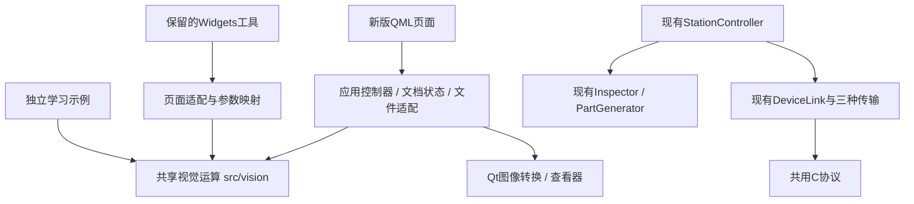

# 项目现状与上位机接续架构

核对：2026-10-16，基于代码、构建清单和应用入口的静态梳理。本次不运行测试、不制作截图、不连接下位机。本文是维护导航；面向读者的架构说明继续写在应用 QML 手册中。

## 项目目标与当前形态

主线是 Qt / QML、OpenCV 学习与可操作的实例。视觉检测工位贯穿演示；F407 是提供通信、控制、采集及 FreeRTOS 学习的配套下位机。不是让 STM32 执行视觉检测，也不是只做一块板子的外设大全。

当前同时保留两套入口：新版 QML 主应用，以及由“实验室”打开的 Widgets 窗口。旧版仍编入同一程序，并非废弃文件；不能因为主导航中没有按钮，就把旧功能判断为未实现。学习示例、手册正文和业务工具各有用途，也不应仅为界面统一而全部重写。

## 功能地图

| 范围 | 已有实现与入口 | 当前角色 |
|---|---|---|
| 主界面 | `qml/Main.qml`、`qml/shell/NavRail.qml`、`qml/Theme.qml` | 工位、设备、数据、手册、实验室；统一主题 |
| 工位检测 | `qml/station/`、`src/app/StationController.*`、`src/vision/Inspector.*`、`PartGenerator.*` | 模拟垫圈、QML画面检测、参数配方、累计统计、结果下发 |
| 检测记录 | `src/app/InspectionSession.*`、`qml/station/ReviewPanel.qml` | 最近60条图像/答案/配方、固定样本、同图比较、电脑JSON归档与错误筛选 |
| 设备与通信 | `src/device/`、`protocol/`、`qml/device/` | 模拟器/RTT/板载USB_232，结构化协议、终端、RTC、六任务运行监控；保留ST-Link入口 |
| 数据分析 | `qml/data/`、`ScopeAnalysis.*`、`ScopeArchive.*` | 传感器曲线、PA4波形、OpenCV DFT、电脑端单帧保存与离线回放 |
| 手册 | `handbook/Index.qml`、`qml/handbook/`、`src/handbook/` | 衔接、Qt、OpenCV、F407、系统五卷；直接引用真实代码；不是外部txt说明页 |
| 交互演示 | `src/demos/`、`qml/demos/` | 信号追踪、死锁、并发、协议帧、Mat共享、阈值/直方图、检测评价 |
| 独立示例 | `examples/`、`examples/CMakeLists.txt` | Qt机制、OpenCV处理/特征/视频/标定/DNN等独立程序及已有输出；不等于都集成到业务工具 |
| 旧实验室入口 | `LegacyLab.*` → `MainWindow` → `ToolManager` | 知识浏览、综合工具箱、旧F407工作台；首次打开时创建 |
| 旧知识体系 | `KnowledgeRegistry*.cpp`、`KnowledgeExplorerPage.*` | Qt基础/架构、OpenCV视觉/工业、Linux环境、F407六类注册源码；新版目录用from记录来源 |
| 正式固件 | `firmware/station/` | 当前范围已完成，维护入口为该目录README；不恢复SD、取消外设或数日运行验证 |
| 历史固件与探针 | `firmware/f407zg/`、`tools/` | 驱动/实验参考与针对性工具；不是自动接续清单，不全量运行 |
| 构建发布 | 根CMake、`scripts/steamdeck-env.sh`、`run.sh`、`.github/workflows/ci.yml` | 本机构建；已有Linux/Windows/macOS发布定义，固件独立构建；本次只做本地提交 |

## 实验室中已经做过的功能

`IntegratedToolboxPage.cpp` 当前实例化六个工具，以下均有实现，不能重新当作新需求：

| 工具 | 已有能力 | 复用与迁移判断 |
|---|---|---|
| `ImageProcessorPage` | 本地图片/屏幕输入、灰度、高斯、固定阈值、Canny、结果图导出 | 优先提取运算；旧滑条的高斯参数映射保留在页面适配层 |
| `LiveScreenPipelinePage` | 屏幕区域/鼠标跟随/整屏输入、滤波、阈值、形态学、轮廓、ORB/Harris、日志 | 已有流式页面；定时器节拍不是实测帧率承诺；处理和UI耦合，后续按实际需求拆分 |
| `VisionMatcherPage` | 屏幕图像、模板加载、相关匹配、阈值与结果定位 | 已有模板匹配功能；未来复用算法，不另写同名工具 |
| `BatchInspectorPage` | 24件合成批次、本地目录、并行检测、PASS/NG筛选、明细和CSV | 检测的是装配孔/表面瑕疵，样本与新垫圈工位不同；不能直接拿其合格率代替分类准确率 |
| `NodeGraphPipelinePage` / `VisionNodeItem` | 图元、连线、预设、输入节点、灰度/滤波/阈值/形态学/轮廓/二维码、连续执行 | 有节点编辑和执行实现；当前队列遍历不是完整的多输入DAG调度器，不宣称已具备合流/环校验/任务取消 |
| `DevToolboxPage` | JSON格式化/压缩、系统信息 | 已实现的辅助工具；不占用视觉主线重复开发 |

`F407WorkbenchPage` 是另一个旧工具，串口动作发送文本命令；当前正式固件通过DeviceLink使用二进制协议。它不是新版设备页的同义入口，不应把旧文本串口直接用于当前固件，也不为迁移图像工具改动它。

## 已有公共能力及边界

- `ScreenCapture`：已有QImage/Mat转换与QScreen采集。采集属于GUI线程/平台能力，不放进纯视觉算法层；跨平台API不等于所有桌面环境均验证可采集。
- `ImageView`：已有QImage等比居中绘制和插值开关。尚无通用图像缩放、平移和ROI交互；波形页的时间轴缩放不是这项能力。
- `StationController` / `InspectionSession`：已有线程池和配方快照的实际用法；复用任务所有权思路，避免再建一套无必要的全局任务框架。
- `Inspector::Steps`：已支持中间图导出，独立示例已经使用；后续步骤查看器对接现有输出，不重写检测管线。
- `ThresholdDemo` / `MatDemo` / `EvalDemo`：已经有阈值、直方图、Mat内存与批量评价交互。手册不是每一节都有交互控件，多数章节以源码/示例输出/图片讲解。
- `.vcinspect.json`固定480×360且有标准答案；`.vcscope.json`存ADC样本。两者不能直接充当通用图像工程文件，暂不强行统一归档格式。

## 修正后的架构

这是目标依赖方向。当前只有四种图像运算提取为ImageOperations并接回旧图像工坊，其他页面尚未全部改用它；图中的独立示例可按需接入，不要求改写所有教学示例。视觉与设备是并列能力，由应用层组合，不是视觉层调用设备层。

- 视觉运算只接收Mat与明确参数，返回结果/错误；不读取控件、不打开文件、不采集屏幕、不发送设备命令。
- 控制器管理原图、参数快照、请求编号和结果发布；文件与QImage适配留在应用层。GUI只提交请求与展示状态。
- 输入图像由提交者保持有效，工作线程使用不可变快照；输出独立持有数据。取消或更换图片后丢弃旧结果，不将旧结果标成新图片。
- 先采用小而明确的运算接口。等节点执行和单图工具确有共同参数/连接需求，再引入算子描述、串行步骤及图调度；当前不预建插件系统或通用任务总线。

## 接续顺序与本轮结果

1. **现状梳理已完成**：按正式QML工具、旧Widgets工具、手册演示、独立示例和板端记录分别核对。前一个“重新做打开图片/灰度/模糊/阈值”的方案修正为复用与迁移。
2. **首个算法提取已完成**：`src/vision/ImageOperations.*`承接旧图像工坊四种运算，页面继续负责参数说明和结果展示；现有入口保留。顺手更正了“自适应二值化”名称，其代码实际为固定阈值，不是新增算法。
3. **下一步补通用图像查看能力**：在现有ImageView基础上提供缩放、平移、适应窗口及坐标约定，并供工位与后续工具复用；这里才是已核实的公共能力缺口。
4. **随后迁移单图入口到QML**：接已有四种运算，补图像文档与后台控制；保留旧入口直到功能对齐。只迁移使用体验和共享服务，不重复实现算法。
5. **再按需要迁移匹配/节点/屏幕流**：各自保留语义与输入输出约束，先复用已提取运算；旧Widgets机制仍可作为Qt学习实例。

本轮不新增测试、不运行测试、不截图；对实际代码变更只编译受影响的目标文件。没有宣称迁移已完成或所有旧功能已运行验收。不推送远程。
