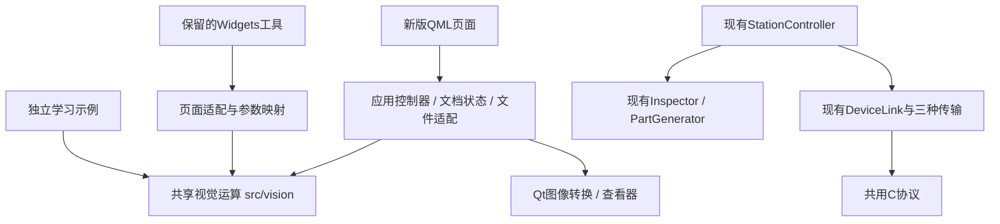

# 项目现状与上位机接续架构

核对：2026-10-17，基于代码、构建清单和应用入口的静态梳理。本次不运行测试、不制作截图、不连接下位机。本文是维护导航；面向读者的架构说明继续写在应用 QML 手册中。

## 教学接续

Qt / OpenCV教学盘点见[LEARNING_MAP.md](LEARNING_MAP.md)，读者入口是手册“衔接 → 学习路线”。本批已完成Qt Quick布局、组件/生命周期、列表/模型，以及OpenCV数组与邻域运算五节，配套五个独立教学示例；本轮另已补齐十二项进阶任务，当前Qt41节、OpenCV51节。已有内容不重新列为工具功能待办。工具服务教学，不再围绕管线存档等能力扩展成实用产品。系统卷已补齐“Qt与OpenCV协作”三节：图像交付、后台结果发布、步骤顺序与中间图；配套examples/integration三个固定数据示例，直接复用ScreenCapture/ImageOperations及已有查看器说明。

十二项进阶课程入口：Qt/QML三节交互，OpenCV/方法对照三节与测量匹配三节，系统/综合课程三节。清单见[TEACHING_ROUND.md](TEACHING_ROUND.md)，本轮只增加课程与教学示例。

## 项目目标与当前形态

主线是 Qt / QML、OpenCV 学习与可操作的实例。视觉检测工位贯穿演示；F407 是提供通信、控制、采集及 FreeRTOS 学习的配套下位机。不是让 STM32 执行视觉检测，也不是只做一块板子的外设大全。

当前同时保留两套入口：新版 QML 主应用，以及由侧栏底部打开的 Widgets 窗口。旧版仍编入同一程序，并非废弃文件；不能因为主导航中没有按钮，就把旧功能判断为未实现。学习示例、手册正文和业务工具各有用途，也不应仅为界面统一而全部重写。

## 功能地图

| 范围 | 已有实现与入口 | 当前角色 |
|---|---|---|
| 主界面 | `qml/Main.qml`、`qml/shell/NavRail.qml`、`qml/Theme.qml` | 工作台 / 视觉实验 / 学习与工具三组，十个直接入口；稳定字符串路由、统一主题 |
| 工位检测 | `qml/station/`、`src/app/StationController.*`、`src/vision/Inspector.*`、`PartGenerator.*` | 模拟垫圈、QML画面检测、参数配方、累计统计、结果下发 |
| 检测记录 | `src/app/InspectionSession.*`、`qml/station/ReviewPanel.qml` | 最近60条图像/答案/配方、固定样本、同图比较、电脑JSON归档与错误筛选 |
| 设备与通信 | `src/device/`、`protocol/`、`qml/device/` | 模拟器/RTT/板载USB_232，结构化协议、终端、RTC、六任务运行监控；保留ST-Link入口 |
| 数据分析 | `qml/data/`、`ScopeAnalysis.*`、`ScopeArchive.*` | 传感器曲线、PA4波形、OpenCV DFT、电脑端单帧保存与离线回放 |
| 手册 | `handbook/Index.qml`、`qml/handbook/`、`src/handbook/` | 衔接、Qt、OpenCV、F407、系统五卷；直接引用真实代码；不是外部txt说明页 |
| 交互演示 | `src/demos/`、`qml/demos/` | 信号追踪、死锁、并发、协议帧、Mat共享、阈值/直方图、检测评价 |
| 独立示例 | `examples/`、`examples/CMakeLists.txt` | Qt机制、OpenCV处理/特征/视频/标定/DNN等独立程序及已有输出；不等于都集成到业务工具 |
| QML图像工坊 | `src/app/ImageWorkshop.*`、`qml/workshop/ImageWorkshopPage.qml` | 视觉实验分组入口；打开/示例/手动屏幕取图、后台四种处理、原图对比、PNG/JPEG导出；旧入口保留 |
| QML实验工具 | `qml/tools/`、`src/app/VisionRunner.*`、`BatchInspector.*`、`DevTools.*`、`src/vision/LabAlgorithms.*` | 模板匹配、批量质检、屏幕流、可编辑节点管线、JSON/系统信息；后台运算与共享查看器 |
| 旧实验室入口 | `LegacyLab.*` → `MainWindow` → `ToolManager` | 知识浏览、综合工具箱、旧F407工作台；首次打开时创建 |
| 旧知识体系 | `KnowledgeRegistry*.cpp`、`KnowledgeExplorerPage.*` | Qt基础/架构、OpenCV视觉/工业、Linux环境、F407六类注册源码；新版目录用from记录来源 |
| 正式固件 | `firmware/station/` | 当前范围已完成，维护入口为该目录README；不恢复SD、取消外设或数日运行验证 |
| 历史固件与探针 | `firmware/f407zg/`、`tools/` | 驱动/实验参考与针对性工具；不是自动接续清单，不全量运行 |
| 构建发布 | 根CMake、`scripts/steamdeck-env.sh`、`run.sh`、`.github/workflows/ci.yml` | 本机构建；已有Linux/Windows/macOS发布定义，固件独立构建；本次只做本地提交 |

## 实验室中已经做过的功能

`IntegratedToolboxPage.cpp` 当前实例化六个工具，以下均有实现，不能重新当作新需求：

| 工具 | 已有能力 | 复用与迁移判断 |
|---|---|---|
| `ImageProcessorPage` | 本地图片/屏幕输入、灰度、高斯、固定阈值、Canny、结果图导出 | ImageOperations与ImageWorkshop已承接；旧滑条参数映射保留在旧页面适配层 |
| `LiveScreenPipelinePage` | 屏幕区域/鼠标跟随/整屏输入、滤波、阈值、形态学、轮廓、ORB/Harris、日志 | 新版StreamPage/VisionRunner/LabAlgorithms已承接；单任务丢弃过期采样，显示实际完成帧率，离开页停止 |
| `VisionMatcherPage` | 屏幕图像、模板加载、相关匹配、阈值与结果定位 | 新版MatcherPage已承接；单处归一化相关匹配，明确分数不等于概率 |
| `BatchInspectorPage` | 24件合成批次、本地目录、并行检测、PASS/NG筛选、明细和CSV | 新版BatchPage/BatchInspector已承接；保留装配板语义，独立线程池和CSV；修正标准安装孔误计与红色划痕漏提取，不改旧实现 |
| `NodeGraphPipelinePage` / `VisionNodeItem` | 图元、连线、预设、输入节点、灰度/滤波/阈值/形态学/轮廓/二维码、连续执行 | 新版NodesPage已承接；9类节点、增删/拖动/连断/预设/参数/单次与连续执行/逐节点预览，NodeProject保存/打开.vcgraph.json工程与未保存提醒；新增单输入图校验，仍不提供多输入合流 |
| `DevToolboxPage` | JSON格式化/压缩、系统信息 | 新版DevToolsPage已承接；复用nlohmann-json，显示实际编译器信息 |

`F407WorkbenchPage` 是另一个旧工具，串口动作发送文本命令；当前正式固件通过DeviceLink使用二进制协议。它不是新版设备页的同义入口，不应把旧文本串口直接用于当前固件，也不为迁移图像工具改动它。

## 已有公共能力及边界

- `ScreenCapture`：已有QImage/Mat转换与QScreen采集。采集属于GUI线程/平台能力，不放进纯视觉算法层；跨平台API不等于所有桌面环境均验证可采集。
- `ImageView`：已有QImage等比绘制、插值开关，现已补充显式启用的缩放、平移、1:1、坐标/像素读取；`qml/data/ImageViewer.qml`提供统一工具栏。工位原图/结果与记录回看已接入。ROI选区尚未实现；波形页保持自己的时间轴。
- `StationController` / `InspectionSession`：已有线程池和配方快照的实际用法；复用任务所有权思路，避免再建一套无必要的全局任务框架。
- `Inspector::Steps`：已支持中间图导出，独立示例已经使用；后续步骤查看器对接现有输出，不重写检测管线。
- `ThresholdDemo` / `MatDemo` / `EvalDemo`：已经有阈值、直方图、Mat内存与批量评价交互。手册不是每一节都有交互控件，多数章节以源码/示例输出/图片讲解。
- `.vcinspect.json`固定480×360且有标准答案；`.vcscope.json`存ADC样本。两者不能直接充当通用图像工程文件，暂不强行统一归档格式。

## 修正后的架构

这是新界面的依赖方向。四种图像工坊运算由ImageOperations共享，新实验工具由LabAlgorithms承接旧算法并明确参数；旧Widgets代码按用户要求继续保留，不为迁移批量改写旧页。图中的独立示例可按需接入，不要求改写所有教学示例。视觉与设备是并列能力，由应用层组合，不是视觉层调用设备层。

- 视觉运算只接收Mat与明确参数，返回结果/错误；不读取控件、不打开文件、不采集屏幕、不发送设备命令。
- 控制器管理原图、参数快照、请求编号和结果发布；文件与QImage适配留在应用层。GUI只提交请求与展示状态。
- 输入图像由提交者保持有效，工作线程使用不可变快照；输出独立持有数据。取消或更换图片后丢弃旧结果，不将旧结果标成新图片。
- 先采用小而明确的运算接口。等节点执行和单图工具确有共同参数/连接需求，再引入算子描述、串行步骤及图调度；当前不预建插件系统或通用任务总线。

## 接续顺序与本轮结果

1. **现状梳理已完成**：按正式QML工具、旧Widgets工具、手册演示、独立示例和板端记录分别核对。前一个“重新做打开图片/灰度/模糊/阈值”的方案修正为复用与迁移。
2. **首个算法提取已完成**：`src/vision/ImageOperations.*`承接旧图像工坊四种运算，页面继续负责参数说明和结果展示；现有入口保留。顺手更正了“自适应二值化”名称，其代码实际为固定阈值，不是新增算法。
3. **通用图像查看能力已接入**：ImageView实现缩放、平移、适应窗口、1:1与原图像素坐标/RGB，ImageViewer提供统一工具栏，已用于工位和记录回看。检测始终抓取独立的完整传送带图层，查看器的变换和工具栏不进入算法输入；默认只显示的手册演示保持原交互。
4. **单图入口已迁移到QML**：实验室直接展示ImageWorkshopPage，ImageWorkshop管理原图、文件与单任务后台处理，复用四种公共运算和ImageViewer。支持180 ms合并自动预览/手动执行、过期结果标记、中文路径、手动屏幕取图和PNG/JPEG原分辨率导出，旧Widgets入口保留。没有为本次迁移新增测试、截图或设备操作。
5. **剩余工具已补齐QML入口（2026-10-17）**：模板匹配、装配板批量质检、屏幕流、节点编辑执行、开发工具箱。新版共用查看器、Theme、输入组件和小型页面控件；运算与文件适配放在vision/app。旧Widgets文件本轮不修改。
6. **侧栏目录已重构**：工作台（工位/设备/数据），视觉实验（工坊/匹配/批量/屏幕流/节点），学习与工具（手册/开发工具）；底部常驻旧版与主题。VC_PAGE=0..4兼容，5..9扩展新页；切换工具不销毁状态，连续采集离页即停。说明见handbook/system/workshop/LabTools.qml。

节点工程接续：NodeProject负责256 KiB版本1文件的结构校验与QSaveFile提交；NodesPage保存节点、布局、参数、连线及选中节点。支持草稿、另存为与替换/退出前未保存提醒，加载失败保留画布，打开后不自动执行，不保存运行图像。

本轮只做代码核对和正式应用编译，不新增/运行测试或截图，不操作设备。QML功能迁移已实现；未进行交互运行验收，不宣称所有平台屏幕采集已验证。本地提交，不推送远程。
