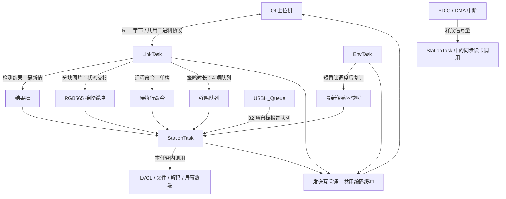

# 当前下位机任务架构

核对日期：2026-10-15。实现基线：`66ad20c`；A01 已增加设备页/终端共用任务快照，未调整任务划分；验证见 `handbook/f407/rtos/task-monitor-test.txt`。后续工作见 [扩充方案.md](扩充方案.md)。

范围为 `firmware/station`。`firmware/f407zg` 是保留的旧实现和驱动参考；手册中的调试器实验、临时实验固件也不能直接算作此架构的组成部分。

## 启动和任务

启动顺序见 [main.c](Core/Src/main.c)：HAL/时钟与外设 → 屏幕初始化 → `osKernelInitialize` → `MX_FREERTOS_Init` 创建共享对象及三个应用任务 → `osKernelStart`。

三个任务由 `.ioc` 声明，[freertos.c](Core/Src/freertos.c) 生成属性和创建代码；实际入口由 `App/` 的强定义提供。生成文件末尾的弱 `LinkTask` 不是实际通信循环；当前 USB 主机是在 `StationTask → mouse_init → MX_USB_HOST_Init` 路径启动的。

| 实际任务 | CMSIS 优先级 | 栈分配 | 入口和职责 |
|---|---|---:|---|
| linkTask | AboveNormal，32 | 2048 B | [LinkTask](App/link.c)：轮询 RTT、拆帧、处理协议命令、回应答、接收结果和图片；无数据时延迟 1 tick |
| stationTask | Normal，24 | 8192 B | [StationTask](App/station.c)：按键、触摸、鼠标、蜂鸣器、页面后台和刷新、终端命令、文件读卡/解码、健康检查及喂狗 |
| envTask | BelowNormal，16 | 1536 B | [EnvTask](App/env.c)：温度、光照、VDDA 采样及遥测；最新快照目标每 500 ms 更新，遥测按订阅周期；循环延迟 10 tick |
| USBH_Queue | Normal，24 | 1024 B | USB 主机库在 `USBH_Init` 创建，执行枚举和 HID 处理；鼠标回调在此任务上下文，不是硬件 ISR |
| IDLE | 内核默认 | 内核配置 | 空闲任务 |
| Tmr Svc | FreeRTOS 配置为 2 | 256 words | 软件定时器服务任务；不是每个页面各有一个任务 |

优先级数值来自 CMSIS-RTOS2 配置，栈大小单位为字节。`.ioc` 的深度经 CubeMX 转成 `.stack_size = 深度 * 4`；不要把 CMSIS 的字节数与 FreeRTOS 原生接口的 word 数混用。

当前节拍配置为 1 kHz，但“循环等待 10 ms”“每 20 ms 检查一次”是目标节奏，不能视为严格的周期保证：任务内部工作、抢占和等待都会延长间隔。

## 数据如何交接

| 交接内容 | 当前机制及语义 | 代码入口 |
|---|---|---|
| 协议发送 | 一个互斥锁保护共用组帧缓冲；三个应用任务都可能发送，取得锁后仍可能等待 RTT 空间 | `App/app.c: app_send` |
| 蜂鸣请求 | 4 个 `uint16_t` 时长的队列，非阻塞投递，满时丢弃；StationTask 负责 PWM 开关 | `App/app.c: app_beep`、`App/station.c` |
| 检测结果 | 单槽最新值，短暂锁调度交接，不保证逐条结果都被画出 | `app_post_result` / `app_take_result` |
| 图片 | 一个 160×120×2 B 缓冲，IDLE/RECEIVING/READY/DRAWING 状态交接；写完有内存屏障，绘制后归还；就绪/绘制时不接受新图 | `App/app.c`，`App/page_station.c: pages_background` |
| 远程命令 | 一个待执行命令槽；满时拒绝。LinkTask 投递，StationTask 取出、执行并按原序号回包 | `app_post_shell` / `app_take_shell`、`App/page_term.c: term_remote_poll` |
| 传感器快照 | EnvTask 更新，读取时用 `osKernelLock` 保护短结构体复制；不是屏蔽中断，不能据此允许 ISR 同时修改 | `App/env.c: app_latest_sensors` |
| 鼠标输入 | 库任务向 32 项报告队列非阻塞投递，满时增加丢弃计数；StationTask 取出后形成指针事件 | `App/mouse.c`、`App/station.c` |
| SD DMA 完成/错误 | 回调停数据通道、清标志并释放信号量；读任务在原调用处恢复执行 | `App/sdcard.c` |
| EEPROM | 独立互斥锁协调配方与设置等访问；访问可能阻塞，不属于发送互斥锁 | `App/eeprom.c` |

这里没有统一的“所有事件都经过一个队列”的总线，也没有独立存储任务或解码任务。`app.c` 是交接接口集合，不是第四个任务。

## StationTask 的实际工作量

1. 从蜂鸣队列最多等待 10 ms，处理 PWM 的开启和到期关闭，扫描/消抖实体按键。
2. 目标每 20 ms 读取触摸，取鼠标与调试注入事件，更新活动时间。
3. 检查故障注入、健康状态，执行闲置调暗策略。
4. `pages_background` 在任何前台页面下都接收结果、消费图片、执行远程命令并维护传感器历史。
5. 目标每 20 ms 调用当前页 `gui_tick`；LVGL 页在自己的 tick 中运行 `lv_port_run`。

文件页的 `fs_list`、`photo_read`、文本读取、JPEG 解码，以及终端的 `shell_exec` 都在这个任务中。DMA 等待让 CPU 可调度其他任务，但 **StationTask 本身不会同时继续刷新界面、读输入或喂狗**。降低其他任务的优先级也不能让一个正在等待的 StationTask 同时做这些工作。

LVGL 控件由 StationTask 操作；`App/lv_ui.c` 在进入页面时创建、离开时销毁，页面数据按需保留在控件外。任何未来工作任务都应交付结果，由 StationTask 更新控件。

## 看门狗与故障处理

`LinkTask`、`EnvTask` 每轮报到；`StationTask` 在 `health_feed` 中报到并检查另外两个任务，满足健康条件才喂 IWDG。USB 库任务没有单独纳入三个健康槽。

- 其他应用任务不再报到：记录其任务名并停止喂狗。
- StationTask 自己卡住：它无法执行健康检查，可能只有看门狗复位标志，没有任务挂起记录。本轮 SCR 等待复位就是排查这一类问题的实例。
- `configCHECK_FOR_STACK_OVERFLOW=2` 已启用，溢出钩子记录任务并复位。
- HardFault 处理保存现场到 `.noinit`，开机读取复位原因与现场，在设备页和终端 `last` 查看。
- 调试暂停时冻结看门狗；故障注入脚本属于验证工具，正常使用不应写入注入变量。

细节及证据见 `App/fault.c`、`handbook/f407/rtos/Fault.qml`、`tools/fault_probe.tcl`、`handbook/f407/gui/files-browser-test.txt`。

## 下一步架构工作：先测量，再决定拆分

任务快照与页面展示（A01）已完成。下一步测量正常空闲、RTT 传图、非存储终端命令和通信并发时的输入延迟、刷新间隔、最长阻塞、锁等待、队列积压和栈余量（A03）。

遵循用户最新要求，后续验证不操作其 SD 卡，不进入文件页或运行存储命令。当前快照每秒采集一次；先在暂停调度期间复制名称和状态，恢复调度后排序，最多十任务，失败时清空显示。实板采集峰值约 0.62 ms，包含可能的抢占；这不是全部负载的最坏上界。

若测量证明需要把慢操作搬出去，候选做法是工作任务拥有文件系统/解码器，使用有界请求队列和完成通知，StationTask 只提交请求与更新界面。引入前必须明确：

- 哪个任务唯一访问 FatFs 和静态解码缓冲；现有实现不能直接多任务并发调用。
- 缓冲区何时可读、何时可重用，离开页面或拔卡后怎样取消旧结果。
- 队列满、超时、失败、连续点击及旧挂载结果的处理方式。
- 工作任务的栈、堆预算与看门狗检查方式；不能靠绕过健康检查隐藏阻塞。

这是建议方案，尚未实现或批准为必选改造。下位机的任务实验应服务 FreeRTOS 学习，并为上位机的 Qt 通信、数据展示提供可验证的交互对象。
