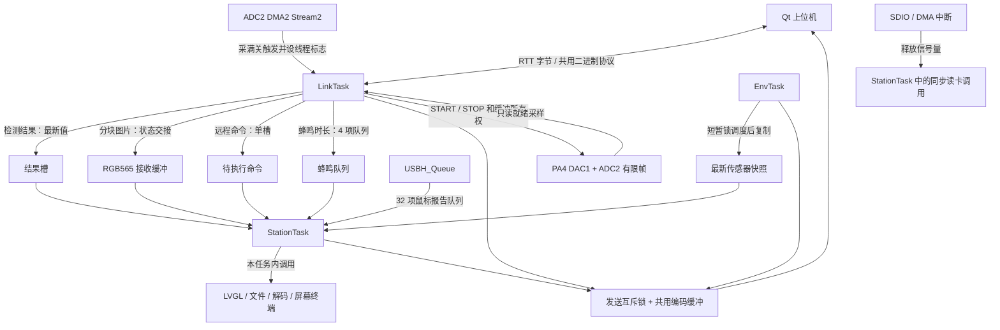

# 当前下位机任务架构

核对日期：2026-10-16。原实现基线：`66ad20c`；A01 已增加设备页/终端共用任务快照，A03 已增加非存储响应计时，均未调整任务划分；验证见 `handbook/f407/rtos/task-monitor-test.txt`、`response-test.txt`。后续工作见 [扩充方案.md](扩充方案.md)。

范围为 `firmware/station`。`firmware/f407zg` 是保留的旧实现和驱动参考；手册中的调试器实验、临时实验固件也不能直接算作此架构的组成部分。

## 启动和任务

启动顺序见 [main.c](Core/Src/main.c)：HAL/时钟与外设 → 屏幕初始化 → `osKernelInitialize` → `MX_FREERTOS_Init` 创建共享对象及三个应用任务 → `osKernelStart`。

三个任务由 `.ioc` 声明，[freertos.c](Core/Src/freertos.c) 生成属性和创建代码；实际入口由 `App/` 的强定义提供。生成文件末尾的弱 `LinkTask` 不是实际通信循环；当前 USB 主机是在 `StationTask → mouse_init → MX_USB_HOST_Init` 路径启动的。

| 实际任务 | CMSIS 优先级 | 栈分配 | 入口和职责 |
|---|---|---:|---|
| linkTask | AboveNormal，32 | 2048 B | [LinkTask](App/link.c)：轮询 RTT、拆帧、处理协议命令、回应答、接收结果和图片；管理波形采集、消费 DMA 线程标志并分块读回；无数据时延迟 1 tick |
| stationTask | Normal，24 | 8192 B | [StationTask](App/station.c)：按键、触摸、鼠标、蜂鸣器、页面后台和刷新、终端命令、文件读卡/解码、健康检查及喂狗 |
| envTask | BelowNormal，16 | 1536 B | [EnvTask](App/env.c)：温度、光照、VDDA 采样及遥测；最新快照目标每 500 ms 更新，遥测按订阅周期；循环延迟 10 tick |
| USBH_Queue | Normal，24 | 1024 B | USB 主机库在 `USBH_Init` 创建，执行枚举和 HID 处理；鼠标回调在此任务上下文，不是硬件 ISR |
| IDLE | 内核默认 | 内核配置 | 空闲任务 |
| Tmr Svc | FreeRTOS 配置为 2 | 256 words | 软件定时器服务任务；不是每个页面各有一个任务 |

优先级数值来自 CMSIS-RTOS2 配置，栈大小单位为字节。`.ioc` 的深度经 CubeMX 转成 `.stack_size = 深度 * 4`；不要把 CMSIS 的字节数与 FreeRTOS 原生接口的 word 数混用。

当前节拍配置为 1 kHz，但“循环等待 10 ms”“每 20 ms 检查一次”是目标节奏，不能视为严格的周期保证：任务内部工作、抢占和等待都会延长间隔。

## 数据如何交接

| 交接内容 | 当前机制及语义 | 代码入口 |
|---|---|---|
| 协议发送 | 一个互斥锁保护共用组帧缓冲；三个应用任务都可能发送，取得锁后仍可能等待 RTT 空间 | `App/app.c: app_send` |
| 蜂鸣请求 | 4 个 `uint16_t` 时长的队列，非阻塞投递，满时丢弃；StationTask 负责 PWM 开关 | `App/app.c: app_beep`、`App/station.c` |
| 检测结果 | 单槽最新值，短暂锁调度交接，不保证逐条结果都被画出 | `app_post_result` / `app_take_result` |
| 图片 | 一个 160×120×2 B 缓冲，IDLE/RECEIVING/READY/DRAWING 状态交接；写完有内存屏障，绘制后归还；就绪/绘制时不接受新图 | `App/app.c`，`App/page_station.c: pages_background` |
| 远程命令 | 一个待执行命令槽；满时拒绝。LinkTask 投递，StationTask 取出、执行并按原序号回包 | `app_post_shell` / `app_take_shell`、`App/page_term.c: term_remote_poll` |
| 传感器快照 | EnvTask 更新，读取时用 `osKernelLock` 保护短结构体复制；不是屏蔽中断，不能据此允许 ISR 同时修改 | `App/env.c: app_latest_sensors` |
| 鼠标输入 | 库任务向 32 项报告队列非阻塞投递，满时增加丢弃计数；StationTask 取出后形成指针事件 | `App/mouse.c`、`App/station.c` |
| SD DMA 完成/错误 | 回调停数据通道、清标志并释放信号量；读任务在原调用处恢复执行 | `App/sdcard.c` |
| EEPROM | 带优先级继承的独立互斥锁，等待20 ms；读写参数/范围检查，普通写禁用保留末页。StationTask 通过统一诊断逐步推进显式自检，不新增任务/队列 | `App/eeprom.c`、`App/eeprom_diag.c` |
| RTC | LinkTask 对时/读回，StationTask 每秒读设备页；带优先级继承的互斥锁串行化，备份寄存器 DR0 标记完整对时，软件复位保留日历 | `App/clock.c`、`Core/Src/rtc.c`；验证 `handbook/f407/analog/clock-sync-test.txt` |
| PA4 波形 | LinkTask 唯一控制，DMA 写2048点静态缓冲；中断关触发并以 CMSIS 线程标志通知，任务停发生器后只读；新采集编号拒绝旧读取，STOP 取消，1秒采集超时 | `App/scope.c`；验证 `handbook/f407/analog/scope-stream-test.txt` |

这里没有统一的“所有事件都经过一个队列”的总线，也没有独立存储任务或解码任务。`app.c` 是交接接口集合，不是第四个任务。

## StationTask 的实际工作量

1. 从蜂鸣队列最多等待 10 ms，处理 PWM 的开启和到期关闭，扫描/消抖实体按键。
2. 目标每 20 ms 读取触摸，取鼠标与调试注入事件，更新活动时间。
3. 检查故障注入、健康状态，执行闲置调暗策略。
4. `pages_background` 在任何前台页面下都接收结果、消费图片、执行远程命令并维护传感器历史。
5. 若统一诊断正在进行，推进一个 SRAM 块或 EEPROM/Flash 备份、测试、恢复步骤；Flash 芯片内部忙时只查状态并交还循环。
6. 目标每 20 ms 调用当前页 `gui_tick`；LVGL 页在自己的 tick 中运行 `lv_port_run`。

文件页的 `fs_list`、`photo_read`、文本读取、JPEG 解码，以及终端的 `shell_exec` 都在这个任务中。DMA 等待让 CPU 可调度其他任务，但 **StationTask 本身不会同时继续刷新界面、读输入或喂狗**。降低其他任务的优先级也不能让一个正在等待的 StationTask 同时做这些工作。

LVGL 控件由 StationTask 操作；`App/lv_ui.c` 在进入页面时创建、离开时销毁，页面数据按需保留在控件外。任何未来工作任务都应交付结果，由 StationTask 更新控件。

## 波形采集协作

A05 的采集不占用 StationTask：DAC 预热和 DMA 等待都由 LinkTask 非阻塞轮询推进。没有新增任务或队列，仍为六个任务；ADC DMA 中断优先级5，DAC DMA 中断优先级6，满足 FreeRTOS 从 ISR 调用线程标志 API 的要求。DAC DMA 不开半传输/完成中断，保留错误通知；ADC 每帧一次完成通知。二十帧并发窗口 GUI 调用间隔峰值27.67 ms，输入标记峰值10.12 ms，DMA错误0，不是所有负载的最坏上界。

## 看门狗与故障处理

`LinkTask`、`EnvTask` 每轮报到；`StationTask` 在 `health_feed` 中报到并检查另外两个任务，满足健康条件才喂 IWDG。USB 库任务没有单独纳入三个健康槽。

- 其他应用任务不再报到：记录其任务名并停止喂狗。
- StationTask 自己卡住：它无法执行健康检查，可能只有看门狗复位标志，没有任务挂起记录。本轮 SCR 等待复位就是排查这一类问题的实例。
- `configCHECK_FOR_STACK_OVERFLOW=2` 已启用，溢出钩子记录任务并复位。
- HardFault 处理保存现场到 `.noinit`，开机读取复位原因与现场，在设备页和终端 `last` 查看。
- 调试暂停时冻结看门狗；故障注入脚本属于验证工具，正常使用不应写入注入变量。

细节及证据见 `App/fault.c`、`handbook/f407/rtos/Fault.qml`、`tools/fault_probe.tcl`、`handbook/f407/gui/files-browser-test.txt`。

## A03 实测与架构决定

任务快照与页面展示（A01）及非存储响应基线（A03）已完成。`App/perf.h` / `perf.c` 固定记录循环/输入轮询/GUI 间隔、后台和 GUI 耗时、命令入槽等待与执行、图像就绪等待与消费、各任务发送锁等待/持有，以及队列水位和拒绝计数。`tools/response_probe.py` 运行四种负载，协议编码/CRC 复用仓库 C 实现。

本轮空闲、诊断并发及五张 RTT 图片：输入轮询标记峰值 ≤9.02 ms，GUI 调用间隔峰值 ≤28.74 ms；图像消费峰值 3.34 ms。五次 180 ms 可抢占工作使输入标记等到 188.06 ms、GUI 间隔达 201.11 ms，但短 PING 最大往返 8.20 ms；三条并发命令每次一条接收、两条 BUSY，后续恢复正常。标记只测 LinkTask 到 StationTask 输入轮询的等待，不是真实触摸到呈现延迟。

发送锁等待峰值约 0.0041 ms，本轮未出现 RTT 丢字节。决定暂时保留当前任务划分；没有把发送另拆成任务的实测依据。未来慢功能优先分步或由有界工作交付结果。真实触摸链路、满 RTT 缓冲/主机停止读取、鼠标/蜂鸣满队列和全部终端命令均未覆盖；这里的峰值不是最坏上界。详细结果和内存见 `handbook/f407/rtos/response-test.txt`，手册新增「界面响应：测量阻塞与任务协作」。

遵循用户最新要求，后续验证不操作其 SD 卡，不进入文件页或运行存储命令。当前快照每秒采集一次；先在暂停调度期间复制名称和状态，恢复调度后排序，最多十任务，失败时清空显示。实板采集峰值约 0.62 ms，包含可能的抢占；这不是全部负载的最坏上界。

若测量证明需要把慢操作搬出去，候选做法是工作任务拥有文件系统/解码器，使用有界请求队列和完成通知，StationTask 只提交请求与更新界面。引入前必须明确：

- 哪个任务唯一访问 FatFs 和静态解码缓冲；现有实现不能直接多任务并发调用。
- 缓冲区何时可读、何时可重用，离开页面或拔卡后怎样取消旧结果。
- 队列满、超时、失败、连续点击及旧挂载结果的处理方式。
- 工作任务的栈、堆预算与看门狗检查方式；不能靠绕过健康检查隐藏阻塞。

以上工作任务是未来出现实际慢路径时的候选方案，当前未实现；A03 基线没有要求立即拆分。下位机的任务实验应服务 FreeRTOS 学习，并为上位机的 Qt 通信、数据展示提供可验证的交互对象。

## EEPROM 分步自检

`eetest start` 仅在 StationTask 中改变诊断状态；后台每轮最多做一次页读或页写。先备份248..255，再测试00/FF/AA/55，最后恢复并读回；取消也进入恢复。恢复未确认保留原值并阻止新测试，`eetest retry` 只重试恢复。备份只在RAM，不承诺中途断电后的末页还原，因此该页永久排除在配方/设置区域之外。

本轮与3帧波形、50 ms遥测并发：诊断单步峰值3.7861 ms，GUI调用间隔峰值27.8097 ms，输入轮询标记峰值9.0132 ms。固定测量窗口不等于最坏延迟，I2C错误在桌面注入，没有强制断开板载芯片。见 `handbook/f407/storage/eeprom-selftest.txt`。

## 统一诊断、SPI Flash 与内存（2026-10-16）

功能提交 `635b763`，设备页实板内存修复 `97a83cf`。设备页按钮、`diag start sram|eeprom|flash` 和兼容的 `eetest` 均由 StationTask 执行；LinkTask 仍只投递命令。`diag_busy` 和两种写入测试的待恢复标记保证排他，状态机不新增任务、队列或FreeRTOS堆分配（LVGL控件使用既有内存池）；结果保留在控件外，离页继续执行。设备页每100 ms刷新诊断状态，每秒刷新任务快照。

- SRAM：只测 `0x680F0000` 起64 KiB暂存区，每轮写或读1 KiB；业务静态区不能进入此区域。
- EEPROM：沿用末页248–255备份/模式/恢复，统一入口新增跨诊断互斥；数据访问仍由已有优先级继承互斥锁保护。
- SPI Flash：SPI1由 StationTask 唯一拥有，HAL同步传输每次最多256字节、单次等待预算5 ms；擦除/编程BUSY分轮查询，阶段预算3秒。预算不是整轮或故障下最坏时延。初始化只识别并读卷头；当前16 MiB芯片的12 MiB旧卷保持原样，自检只开放卷外末扇区4 KiB。未知布局禁写，不自动解除保护位，无整片擦除入口。
- 恢复失败：保留原始RAM备份并禁止新自检；`diag retry` 仅恢复。成功前不要复位、断电或重新烧录。RAM备份没有掉电恢复能力，自检区不用于业务存储。
- RNG：CubeMX启用，无外部引脚。StationTask中的游戏入口和终端取硬件样本；固定测试种子绕过RNG，硬件错误回退时基种子，不把陈旧样本当成功。

| 静态区域 | 链接占用 | 约束 |
|---|---:|---|
| 普通 SRAM | 121648 / 131072 B | DMA波形和图片接收缓冲保留于此 |
| CCM | 63512 / 65536 B | CPU专用组帧/应答移入；DMA不可访问 |
| 外部 SRAM 静态区 | 954628 / 983040 B | 静态末尾至暂存区剩28412 B；链接ASSERT拦截重叠 |
| 外部 SRAM 暂存 | 65536 B | `0x680F0000..0x680FFFFF`；诊断排他使用 |
| 片内 Flash | 489460 / 1048576 B | 本轮正式固件，46.68% |

CCM区为NOLOAD，搬入的组帧/应答缓冲每次使用前都由编码器/命令处理完整填充；不靠上电清零。图片分块统一检查当前偏移、剩余字节数及长度，避免加法溢出；模拟器采用同一协议检查函数。

设备页预建十行任务表时，实板重进发生字形临时缓冲分配断言及看门狗复位；改为按实际任务数建行，六任务路径重进10次通过。LVGL池峰值33636/45056 B，StationTask最少剩栈3996/8192 B，LinkTask1672/2048 B，FreeRTOS最小剩余堆18816 B。桌面128 KiB池未暴露该故障，因此必须在实板测内存。

Flash自检与12帧50 kS/s×1024点、50 ms遥测和PING并发：诊断单步峰值0.5557 ms，GUI间隔峰值24.2001 ms，输入轮询标记峰值9.0131 ms；无RTT/鼠标丢弃。最大长度PING十次、160×120全尺寸图片三张通过CRC和应答检查。数值仅覆盖本轮负载；未访问SD、未重测文件页或声称严格实时上界。完整证据见 `handbook/f407/storage/board-diagnostics-test.txt`。

## Qt运行监控（2026-10-16）

`GET_MONITOR` 0x10 采用独立单槽：LinkTask验证空请求并投递序号，槽满回BUSY；StationTask在后台工作计时区内调用 `monitor_poll`，汇总并发送后释放槽。它与远程shell的单槽相互独立，不新增任务。LVGL内存只由StationTask读取；计时/队列计数在短暂锁调度期间复制，编码和RTT发送在恢复调度后进行。

任务名称、高水位和排序继续复用 `app_snapshot_tasks`；快照不可用时任务行数为零并标明状态，其他资源/故障字段仍有效。schema 1最多678字节数据，静态应答680字节放在外部SRAM，局部快照使用StationTask已有栈；六任务实际数据578字节。新增普通RAM8字节、Flash984字节，CCM不变。新构建静态用量：RAM121656 B，CCM63512 B，外部955308 B，Flash490444 B；外部暂存前余27732 B。

Qt `DeviceLink.getMonitor` 抑制重复在途请求；设备页每秒刷新，可暂停/手动刷新，离页停止轮询；历史限制120次成功更新。超时/坏格式清当前快照，UNKNOWN明确报告不支持并停止重试；断开、HELLO清数据并用epoch拒绝旧回调。任务栈是历史最小余量，响应计时包含抢占与等待，均不能作CPU使用率。

代码：`App/monitor.c`、共用 `protocol/vc_protocol.c`、`src/device/DeviceLink.cpp`、`qml/device/RuntimePanel.qml`。实测、原生QML检查、RTT背压及有限时长稳定性结果见 `handbook/f407/rtos/runtime-monitor-test.txt`；新手册节为 `RuntimeMonitor.qml`。本轮不触碰SD或写入型诊断，原六任务结构保留。

监控实板有限窗口：600.37秒、1125帧、4500次PING、18次RTT客户端重连通过；诱发满缓冲后无新增丢弃/坏帧或堆下降。LVGL峰值33612 B，StationTask剩栈3996 B，LinkTask1664 B，EnvTask1252 B。此窗口不覆盖SD、真实外设断电、任意满队列或数日运行。

随后正式Qt设备页及实板原生QML控件验收通过；读取INFO/RTC等路径后LinkTask最小剩栈1576 B（此前采集窗口1664 B）。两组高水位不混为同一窗口，见记录末段。

## 板载USB串口通道（2026-10-16）

保留原有RTT，同时新增CH340连接的USART1（PA9/PA10、115200 8N1）。CubeMX拥有引脚/外设初始化，App/vc_uart.c拥有USART1中断与收发环形区。RX/TX各2048字节置于外部静态区；中断不调用RTOS、不解析协议，不新增任务或RTOS堆分配。LinkTask每轮公平读取两个通道，各用独立解码器。命令处理前记录来源，远程shell/monitor的单槽同时保存通道，StationTask异步应答回原通道；主动事件发至最近有效命令的通道。两通道共享业务状态，按单上位机操作，不提供两个独立控制会话。

新增link只读命令查看活动通道及UART错误计数。RTT监控字段不改变含义，UART丢弃另查link。当前固件静态占用RAM122808、CCM63512、外部959404、Flash492012字节；外部距暂存区23636字节。实线验证状态以应用手册 `handbook/f407/serial/Uart.qml` 为准。
